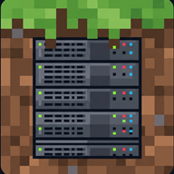

<p align="center">
  
</p>

# Minicraft — Minecraft Java Server on Android

An Android app that turns a phone into a real **Minecraft Java Edition** server, with mod and world management, a live console, resource monitoring, and a [playit.gg](https://playit.gg) tunnel so friends can join without opening router ports.

> **Version 1.0.0.** Private preview.

## Supported

- **Server flavors**: **Vanilla** and **Fabric** (Forge / NeoForge are **not** supported).
- **Minecraft version**: **1.21.1** (primary, tested). **1.20.5 – 1.21** may work but are **untested** — 1.20.5 is known not to start.
- Android 8.0+ (API 26), arm64-v8a only.

## Features

- **Server install**: download Vanilla or Fabric and start from the app.
- **Mod manager**: load `.jar` mods locally or search [Modrinth](https://modrinth.com) and install with one tap.
- **World manager**: import/export worlds from the device.
- **Live console**: run commands, watch server logs in real time.
- **Resource monitor**: TPS, CPU, RAM and players at a glance.
- **Tunnel (playit.gg)**: public address for your server with zero router configuration.
- **Server config**: MOTD, port, RAM, difficulty, game mode and performance presets.
- **Background service**: keeps the server running (foreground service) when the screen turns off.
- **i18n**: English (default) and Spanish, switchable in Settings.

## What's new in 1.0.0

- **Fabric install fixed**: the installer now provisions the Java runtime first, so Fabric no longer fails with exit code 1.
- **Automatic playit.gg setup**: each install claims its own agent (fresh claim code, browser approval) and creates its tunnel automatically — no shared/hardcoded agent.
- **Public tunnel toggle**: Settings now has an *Expose to internet (playit.gg)* switch (on by default). Turn it off to run LAN-only.
- **Launcher icon** and versioned first stable release.

## Download

Get the latest APK from **[Releases](../../releases)** and install it on your device.

> The app downloads its own runtime (JRE) and server files on first use, so you need an internet connection for the initial setup (~150 MB).

## Project layout

| Path | What it is |
|---|---|
| `app/src/main/java/` | App source (UI, server lifecycle, JRE provisioning, playit tunnel) |
| `app/src/main/cpp/` | Native launcher (execve without breaking W^X) |
| `app/src/main/jniLibs/` | `playitd` (BSD-2-Clause) and Java stub binaries |

## Building from source

```bash
./gradlew :app:assembleDebug      # debug
./gradlew :app:assembleRelease    # release (needs local keystore.properties)
```

## License

_TBD — license not yet chosen._
